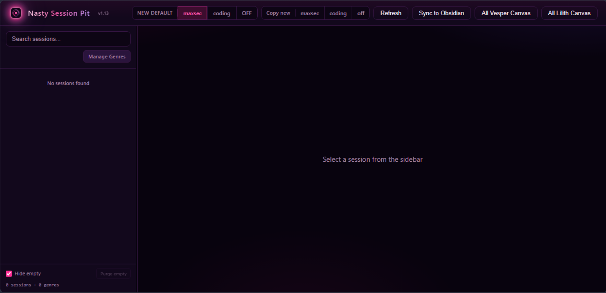

# Nasty Session Pit

Formerly **VesperForge**. Same local power — **cosmic purple / hot magenta** night-ops skin.

Local web UI for browsing, resuming, and syncing **Grok Build** sessions to **Obsidian**.

**Audience:** People who run [Grok Build](https://x.ai) (CLI/TUI) on Linux and keep notes in Obsidian.

**Not for:** Cloud multi-user hosting, non-Grok agents, or generic chat history apps.

## Screenshots

Fresh install / empty state (no sessions yet — expected on a clean machine):



---

## Features

- List local Grok sessions (`~/.grok/sessions/`)
- Search, pin, rename (display aliases stored locally)
- **Direct genre** on each session + collapsible genre tree
- **Related Lilith sessions** — manual id/url + optional title
- **New default** sandbox control (maxsec / coding / off) for plain `grok`
- **Copy new** / **Copy resume** CLI snippets (terminal-first)
- Per-session **launch sandbox** badge (read-only from `summary.json`)
- **Sync to Obsidian** — one click (or CLI) export of session notes + transcripts
- Optional empty-session purge
- **All Vesper / All Lilith Canvas** overview export

UI toolbar: **New default · Copy new · Refresh · Sync to Obsidian · All Canvas**.

---

## Requirements

| Item | Notes |
|------|--------|
| OS | Linux (tested on Ubuntu) |
| Python | 3.10+ |
| Grok Build CLI | `grok` on `PATH` |
| Optional | `tmux` (Open in tmux), Obsidian vault for sync |

---

## Quick start

```bash
# 1. Clone
git clone https://github.com/TX-220/nasty-session-pit.git
cd nasty-session-pit

# 2. Dependencies
python3 -m pip install -r requirements.txt --user

# 3. Optional: install Obsidian exporter on PATH
install -m 755 scripts/grok-export-to-obsidian ~/bin/grok-export-to-obsidian
# (UI Sync also runs scripts/grok-export-to-obsidian from the repo when present)

# 4. Run (listens on 127.0.0.1 only)
python3 server.py
# open http://127.0.0.1:7420/
```

> **Rename note:** GitHub redirects `TX-220/vesper-forge` → `TX-220/nasty-session-pit`.

### Optional launcher (this machine)

If installed as `~/bin/vesper-forge` / hub unit:

```bash
vesper-forge              # start + open browser (legacy name still fine)
vesper-forge --no-open    # server only
vesper-forge --stop       # stop
```

systemd user unit (optional): point `WorkingDirectory` / `ExecStart` at this repo’s `server.py`.

---

## Configuration

| Item | Default |
|------|---------|
| Port | `7420` (`VESPER_HUB_PORT` or `~/.grok/vesper-hub.json` → `settings.port`) |
| Bind | `127.0.0.1` only (local use) |
| Aliases / pins / genres / related Lilith | `~/.grok/vesper-hub.json` |
| Obsidian export dir | `~/obsidian-vault/Second-Brain/Sessions/Vesper/` |

Display names are **aliases** in Hub metadata; they do not rewrite Grok’s `summary.json`.

### Sandbox modes (toolbar)

Top bar segmented control — one click, no CLI memorization:

| Mode | Profile | Meaning |
|------|---------|---------|
| **OFF** | `off` | Full host access — fastest parallel / GPU / net |
| **coding** | `coding` | Everyday isolation — secrets denied, network OK |
| **maxsec** | `maxsec` | Fortress — secrets denied, child network blocked |

**Header “New default”** sets the sandbox for **new** plain `grok` launches (does **not** change existing sessions).

| Layer | Role |
|-------|------|
| `~/.grok/config.toml` `[sandbox] profile=` | Source of truth (persists across reboot) |
| `~/bin/grok` wrapper (+ `~/.local/bin/grok` → wrapper) | Injects that profile when you omit `--sandbox` (beats stale `GROK_SANDBOX` in old shells) |
| bashrc | **Unsets** `GROK_SANDBOX` (no frozen export) |

Each session’s **launch sandbox** is read from `summary.json` → `sandbox_profile` and shown as a **read-only** badge.

- API: `GET /api/sandbox`, `PATCH /api/sandbox` `{ "profile": "maxsec" }`, `POST /api/sandbox/toggle`
- One-shot override: `grok --sandbox off` / `coding` / `maxsec`
- Shell aliases `grok-trade` / `grok-secure` still force maxsec

### Copy commands (terminal-first)

If you do **not** use Open in tmux / New:

| Where | Control | Copies |
|-------|---------|--------|
| Top bar | **Copy new** · maxsec / coding / off | `GROK_SANDBOX=… grok --sandbox …` |
| Session detail | **Copy resume** · maxsec / coding / off | `GROK_SANDBOX=… grok -r <id> --sandbox …` |

Paste into any terminal. **Copy resume** buttons choose sandbox for the *new process* only (★ marks the session’s original launch sandbox). The recorded session sandbox is never rewritten from the UI.

### Related Lilith sessions

Each Vesper session can hold a list of related Lilith (Grok chat) refs:

- **id** — freeform session id or URL
- **title** — optional display name
- Stored in `~/.grok/vesper-hub.json` → `related_lilith[session_id]`
- API: `POST/DELETE /api/sessions/{id}/lilith`

### Direct genre

Each Vesper session can have one **direct genre** from a **user-managed catalog**.

- **Manage** (sidebar next to Genre filter) — add / rename / delete + **color**
- Seed defaults with colors: Information Dominance (purple) · Trade Bot (green) · Game Dev (gold) · Security (red) · Infra & Environment (sky) · Other (gray)
- List / filter / detail selects show genre color (badge + tinted control)
- Unset / Uncategorized use a gray tone
- Rename updates every session using that label; color can change independently
- Delete clears that label on sessions → **Unset** (filter: **Uncategorized**)
- Catalog: `~/.grok/vesper-hub.json` → `genre_catalog` as `[{name, color}, ...]`
- Per-session values: `~/.grok/vesper-hub.json` → `genres`
- API: `GET/POST/PATCH/DELETE /api/genres`, `PUT /api/genres/color`

### Logical sessions (retired)

Viora’s product model is **simple**: each Vesper session has **direct genre** + **Related Lilith** links only.

- **No Logical tab / create UI** (never re-introduced)
- Mutation APIs (`POST/PATCH/DELETE` under `/api/logical-sessions…`) return **410 Gone**
- Read-only dump may still list retained `logical_sessions[]` in hub meta
- Data is **not deleted** from `~/.grok/vesper-hub.json`
- All Vesper Canvas groups by **direct genre only** (no logical fallback)

### Delete (local fallback)

**Delete** prefers `grok sessions delete`. If remote/network fails, Forge removes the local session directory under `~/.grok/sessions` (with path safety checks) so the UI can clean up offline.

### All-sessions overview Canvas

Top bar **All Vesper Canvas** / **All Lilith Canvas** — independent of related-lilith links. No AI classification. Vault save + browser download.

| Button | Source | Output |
|--------|--------|--------|
| All Vesper Canvas | `~/.grok/sessions` (Forge list), light genre groups | `Second-Brain/Sessions/Vesper/All-Vesper-Sessions.canvas` |
| All Lilith Canvas | `Second-Brain/Lilith/Projects/*` folder map | `Second-Brain/Lilith/All-Lilith-Sessions.canvas` |

Lilith overview is also available from **Viora Vault Hub** → *Canvas: All Lilith Sessions Overview* (`Scripts/export_all_sessions_canvas.py --lilith`).

---

## Main commands

| Action | How |
|--------|-----|
| Open UI | `python3 server.py` (or local `vesper-forge` launcher) |
| Sync all sessions → Obsidian | UI **Sync to Obsidian**, or: |
| | `grok-export-to-obsidian --all --import-remote --force` |
| Resume session (CLI) | `grok -r <SESSION_ID> --sandbox off` |
| List sessions (CLI) | `grok sessions list` |

Sync output (genre folders under `Sessions/Vesper/`):

```text
Sessions/Vesper/
  Information Dominance/
    YYYY-MM-DD-<title>-<id8>.md
    YYYY-MM-DD-<title>-<id8>-transcript.md
  Trade Bot/
    …
  Uncategorized/          # genre unset
    …
```

- Genre comes from Forge hub meta (`vesper-hub.json` → `genres`)
- Re-sync with `--force` relocates notes when the session genre changes
- `All-*-Sessions.canvas` stay at the Vesper/Lilith roots (not inside genre folders)

---

## Out of scope (by design)

- Remote multi-user / reverse proxy auth
- Editing Grok session transcripts in place
- Non-Grok session sources
- Heavy plugin marketplace packaging (review pending)

---

## Known limits

- Linux-focused; other OS untested
- Obsidian path is fixed to a conventional vault layout (override requires code change today)
- “Open in tmux” requires a working tmux server
- Session delete uses `grok sessions delete` (irreversible)

---

## Security

- Server binds to **localhost only**
- Does not ship credentials; uses local Grok session store
- Treat export notes as private if sessions contain secrets

---

## License

MIT — see [LICENSE](./LICENSE).

Copyright (c) 2026 TX-220 with assistance from [Grok (xAI)](https://x.ai).

---

## Version

`1.13` — Public rebrand **Nasty Session Pit**; sandbox NEW DEFAULT wiring + UI clarity (session launch badge, Copy new/resume)

`1.7.0` — Sidebar genre directory tree (collapsible folders); pin as star only; project/cwd grouping and genre filter select removed

`1.6.0` — Related Lilith; user-managed genres + colors; Obsidian sync into genre folders; Logical sessions retired; All Canvas; delete local fallback; English UI
